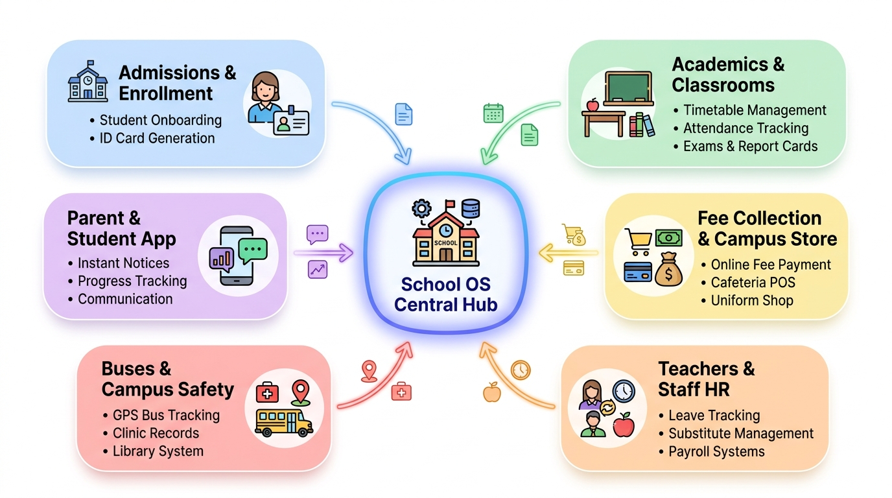
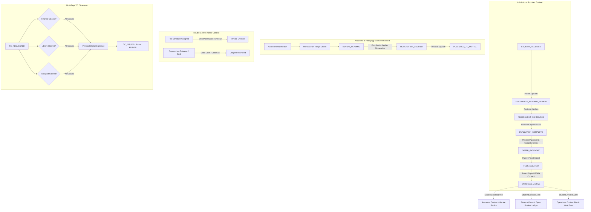

# School Operating System (School OS)
## The Complete Operating System for the Whole School



> **Quick Start:** For the easy-to-understand, complete guide explaining how the entire school runs from A to Z, read [**`WHOLE_SCHOOL_WORKFLOW.md`**](./docs/architecture/WHOLE_SCHOOL_WORKFLOW.md).

---

### 1. Executive Summary: Running the Whole School on One Platform

The modern school is a complex sociotechnical ecosystem spanning pedagogical delivery, financial accounting, human resources, physical operations, and statutory compliance. Traditional approaches fail because they either:
1. Treat the system as a monolithic database ("Big Ball of Mud"), entangling student billing with academic records, medical notes, and transport routes.
2. Rely on hyper-automation and autonomous AI grading/profiling, which strips away relational context, introduces bias, violates child privacy, and causes dashboard fatigue for teachers.
3. Outsource storage to consumer cloud platforms (e.g., Google Photos) that monetize or algorithmically profile minors' biometric and visual data.

The **School OS Workflow Architecture** establishes a **Human-Centric**, **Domain-Driven**, **Event-Driven**, and **Calm Technology-compliant** operating model.

```
                          +------------------------------------------------+
                          |            Human-in-the-Loop (HITL)            |
                          |  "Why Loop": Human Discretion, Pastoral Care,  |
                          |      Executive Sign-off, Legal Verification    |
                          +-----------------------+------------------------+
                                                  |
                                                  | Gate Triggers & Direct Approvals
                                                  v
+--------------------------------------------------------------------------------------------------+
|                                    DETERMINISTIC WORKFLOW ENGINE                                 |
|                                                                                                  |
|   +-----------------------+   +-----------------------+   +----------------------------------+   |
|   | Admissions & Pipeline |   | Academic & Moderation |   | Multi-Dept Clearance (TC/Alumni) |   |
|   +-----------+-----------+   +-----------+-----------+   +----------------+-----------------+   |
|               |                           |                                    |                 |
|               | StudentEnrolledEvent      | ResultsPublishedEvent              | TCCompletedEvent|
|               v                           v                                    v                 |
|   +------------------------------------------------------------------------------------------+   |
|   |                           Transactional Outbox & Domain Event Bus                        |   |
|   +------------------------------------------------------------------------------------------+   |
|               |                                       |                                          |
|               v                                       v                                          v
|   +-----------------------+               +-----------------------+                  +---------------+   |
|   | Double-Entry Finance  |               |  Operations & Assets  |                  | DPDPA Consent |   |
|   | (AR, Revenue, POS)    |               |  (Library, Transport) |                  | & Audit Trail |   |
|   +-----------------------+               +-----------------------+                  +---------------+   |
|                                                                                                  |
+-------------------------------------------------+------------------------------------------------+
                                                  |
                                                  v
                          +------------------------------------------------+
                          |                 Calm UX Layer                  |
                          |   Exception-Based Alerts, Zero-Overhead Data   |
                          |     Entry (<2 min), No Invasive Surveillance   |
                          +------------------------------------------------+
```

---

### 2. Foundational Pillars

#### A. Domain-Driven Design (DDD) & Strategic Context Mapping
* **Bounded Contexts**: Rigid segregation of domain logic into autonomous contexts:
  * `Admissions & Enrollment`
  * `Academic & Pedagogy`
  * `Finance & Billing`
  * `Human Resources`
  * `Operations & Infrastructure`
  * `Core Identity & Access`
* **Anti-Corruption Layer (ACL)**: Deployed at boundaries interfacing with external or legacy systems (e.g., state educational reporting like UDISE+ in India, Ed-Fi in the US, legacy SIS, or external banking gateways) to prevent schema pollution.
* **Aggregates & Invariants**: Enforcing strict consistency boundaries (e.g., `StudentLedger` guarantees double-entry balance; `ClassSection` guarantees teacher-student ratios; `Application` guarantees verification steps).

#### B. Human-in-the-Loop (HITL) & Calm Technology
* **The "Why Loop" vs. "How Loop"**:
  * **"How Loop" (Automated Engine)**: Mechanical validation, outbox event dispatch, ledger arithmetic, double-entry journal balance checks, constraint checks, PDF compilation.
  * **"Why Loop" (Human Authority)**: Admissions committee decisions, subjective mark evaluations, board examination moderation adjustments, financial concessions, child safeguarding reports, and expulsion/TC issuance.
* **Calm UX Design**:
  * **Exception-based reporting**: Eliminates endless dashboard scanning. Teachers and staff are notified *only* when thresholds are breached (e.g., attendance < 75%, 3 consecutive unsubmitted assessments).
  * **Zero-overhead entry**: Bulk default actions for daily routines (e.g., marking entire class present, unchecking absentees in < 120 seconds).
  * **Zero algorithmic surveillance**: No keystroke loggers, emotion detectors, or facial-recognition sentiment trackers.

#### C. Privacy, Data Sovereignty & DPDPA 2023 Compliance
* **Data Fiduciary Responsibility**: Every child (< 18 years) is safeguarded by strict purpose limitation and verifiable parental consent (Section 9, DPDPA 2023).
* **Storage Limitation & Erasure**: Automated lifecycle triggers purge transient telemetry, visitor records, and draft notes upon purpose completion, leaving only permanent statutory transcripts.
* **Zero Third-Party Consumer Cloud Scraping**: Document and student media storage is hosted on encrypted, self-governed S3-compatible blob stores (AES-256 at rest, TLS 1.3 in transit) with pre-signed ephemeral URLs, bypassing consumer services like Google Photos.
* **Statutory Incident Response**: Automated audit logs support 6-hour CERT-In breach reporting and 72-hour Data Protection Board notifications.

---

### 3. Architecture Specification Directory

Detailed sub-specifications are organized as follows:

| Document | Purpose |
| :--- | :--- |
| **[`WHOLE_SCHOOL_WORKFLOW.md`](./docs/architecture/WHOLE_SCHOOL_WORKFLOW.md)** | **Complete, simple, jargon-free guide on how every department in the school connects and runs.** |
| **[`SIMPLE_EXPLAINER.md`](./docs/architecture/SIMPLE_EXPLAINER.md)** | Simple, plain-English 3-minute visual walkthrough for school leaders & teachers. |
| **[`WORKFLOW_SPECIFICATION.md`](./docs/architecture/WORKFLOW_SPECIFICATION.md)** | Exhaustive technical workflow blueprint with end-to-end trace routes and API contracts. |
| **[`STATE_MACHINES.md`](./docs/architecture/STATE_MACHINES.md)** | Finite state machines for Admissions, Assessment Moderation, TC Multi-Department Clearance, and Fee Billing. |
| **[`DOMAIN_EVENTS.md`](./docs/architecture/DOMAIN_EVENTS.md)** | Domain events catalog, outbox pattern, asynchronous orchestration, and idempotency guarantees. |
| **[`RBAC_HITL_MATRIX.md`](./docs/architecture/RBAC_HITL_MATRIX.md)** | Human approval gates, role-based access control, the 4 security questions, and Calm UX guidelines. |
| **[`DATA_PRIVACY_DPDPA.md`](./docs/architecture/DATA_PRIVACY_DPDPA.md)** | Parental consent lifecycle, purpose limitation silos, audit trails, and statutory compliance (DPDPA/GDPR). |
| **[`C4_DIAGRAMS.md`](./docs/architecture/C4_DIAGRAMS.md)** | Simon Brown C4 Model visual architecture: System Context (L1), Container (L2), and Component (L3). |
| **[`WORKFLOW_SPECIFICATION.md`](./docs/architecture/WORKFLOW_SPECIFICATION.md)** | Exhaustive technical workflow blueprint with end-to-end trace routes and API contracts. |

---

### 4. High-Level Workflow Interaction Map


