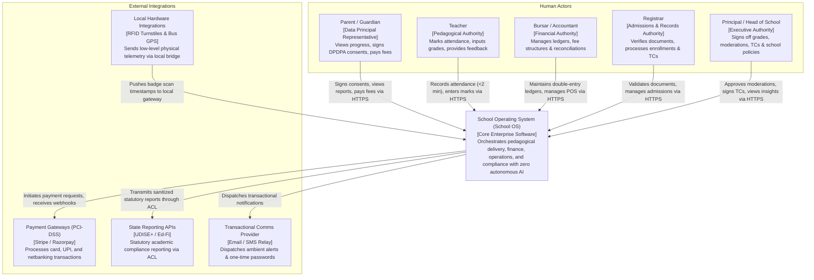
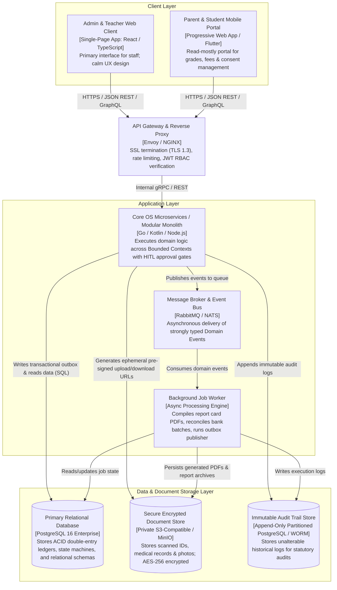
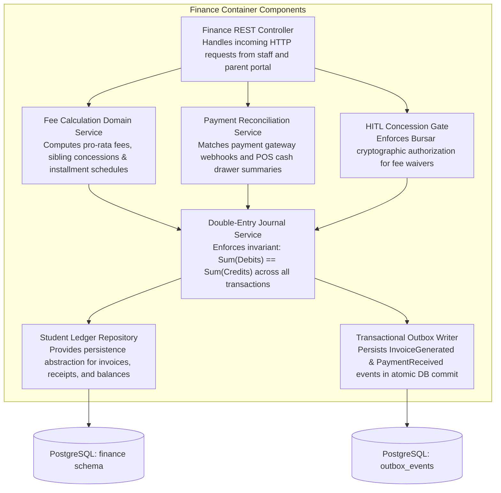

# School OS: Structural Architecture Visualization (C4 Model)

The School OS architecture is documented using the **C4 Model** (Context, Containers, Components, and Code) created by Simon Brown. It uses clear, directional relationships labeled with explicit action verbs.

---

## Level 1: System Context Diagram

The System Context diagram illustrates the School OS as a central system, its primary human actors, and external system integrations.

---

## Level 2: Container Diagram

The Container diagram shows the high-level deployable units, separation of concerns, and data storage solutions.

---

## Level 3: Component Diagram (Finance & Billing Subsystem)

The Component diagram decomposes the `Finance API Container` into its internal domain components.

---

## Architectural Rationale: Simon Brown Principles

1. **Clear Directional Arrows**: Every arrow specifies the direction of data flow and protocol.
2. **Explicit Technology Tags**: Databases, protocols, and architectural layers are concretely annotated.
3. **Strict Isolation**: External entities cannot directly access data stores; all traffic flows through authenticated API Gateways and Domain Repositories.
