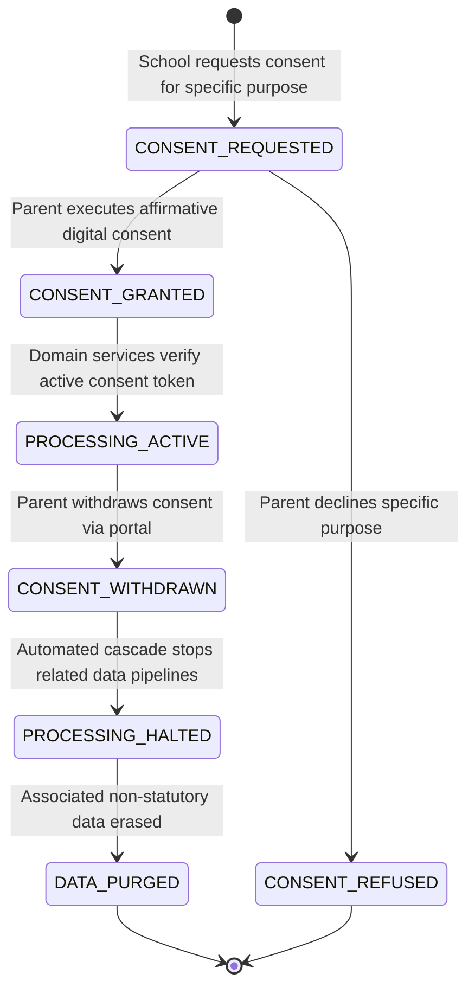

# School OS: Privacy, Data Sovereignty & DPDPA Compliance

## 1. Statutory Context: The Digital Personal Data Protection Act (DPDPA) 2023

In modern schools, children are vulnerable Data Principals. Under Section 9 of India's **Digital Personal Data Protection Act (DPDPA) 2023**, any individual below the age of 18 is legally classified as a child. This confers heightened statutory duties upon the educational institution acting as a **Data Fiduciary**.

```
+---------------------------------------------------------------------------------+
|                       DPDPA 2023 STATUTORY COMPLIANCE VAULT                     |
+---------------------------------------------------------------------------------+
|  1. Verifiable Parental Consent (Section 9)                                    |
|     - Affirmative, explicit, unbundled consent items.                          |
|     - Real-time dynamic right to withdraw consent with immediate downstream stop|
+---------------------------------------------------------------------------------+
|  2. Strict Purpose Limitation & Architectural Silos                             |
|     - Academic exam data != Marketing or Alumni data                           |
|     - Hard prohibition on tracking, profiling, or behavioral monitoring        |
+---------------------------------------------------------------------------------+
|  3. Data Sovereignty & Storage Security                                         |
|     - AES-256 encrypted at rest; TLS 1.3 in transit.                           |
|     - Private S3-compatible Blob Store (No Google Photos or public indexers).  |
+---------------------------------------------------------------------------------+
|  4. Timely Incident & Breach Escalation                                         |
|     - CERT-In statutory notice within 6 hours of discovery.                    |
|     - Data Protection Board (DPB) and Parent notification within 72 hours.     |
+---------------------------------------------------------------------------------+
|  5. Grievance Redressal & Right to Erasure                                      |
|     - Acknowledge complaints within 24h; resolve within 15 business days.       |
|     - Automated storage limitation purges non-statutory records on graduation. |
+---------------------------------------------------------------------------------+
```

---

## 2. Verifiable Parental Consent Lifecycle

### Consent State Machine



### Unbundled Purpose Catalog
Generic blanket consents ("I agree to all school terms") are legally void under DPDPA. The School OS tracks distinct purpose tokens:
1. `PURPOSE_CORE_ACADEMIC`: Required for instruction, grading, and statutory state reporting.
2. `PURPOSE_CAMPUS_ACCESS_RFID`: Optional biometric/RFID badging for automated gate turnstiles.
3. `PURPOSE_PUBLIC_MEDIA`: Use of photographs/videos in school newsletters or annual publications.
4. `PURPOSE_MEDICAL_DISCLOSURE`: Sharing emergency medical allergies with catering and transport staff.
5. `PURPOSE_THIRD_PARTY_EDTECH`: Access to third-party digital learning applications.

### Right to Withdraw Consent Cascade
When a parent clicks **Withdraw Consent** for `PURPOSE_PUBLIC_MEDIA`:
1. `ConsentWithdrawnEvent` is published to the event bus.
2. The `Media Asset Service` immediately flags all media tagged with the student's ID as `RESTRICTED_DO_NOT_PUBLISH`.
3. The content delivery pipeline revokes public pre-signed URLs for those assets within 60 seconds.

---

## 3. Data Sovereignty: Private Object Storage vs. Consumer Platforms

A critical vulnerability in legacy schools is using consumer cloud tools like Google Photos, Google Drive, or public Dropbox for student media and scanned documents. This introduces:
* Uncontrolled third-party automated scanning and facial indexing.
* Potential training of commercial models on student biometric traits.
* Violation of cross-border data transfer limitations.

### School OS Storage Architecture

```
+-------------------------------------------------------------------------+
|                           CLIENT APPLICATION                            |
+--------------------+-------------------------------+--------------------+
                     | 1. Request Secure Upload       ^ 3. Ephemeral View
                     v                                |    (Pre-signed URL,
+--------------------+--------------------+           |     TTL: 15 mins)
| API GATEWAY & ACCESS CONTROLLER         |           |
| (Checks RBAC, verifies active consent)  |           |
+--------------------+--------------------+           |
                     | 2. Issues Pre-signed S3 URL    |
                     v                                |
+--------------------+--------------------------------+-------------------+
|               PRIVATE ENCRYPTED OBJECT STORE (S3 / MINIO)              |
|                                                                         |
|   /tenants/{tenant_id}/admissions/docs/{doc_id}.enc                     |
|   /tenants/{tenant_id}/student_media/{student_id}/{photo_id}.enc       |
|                                                                         |
|   * Server-Side Encryption: AES-256 (KMS Managed Customer Keys)        |
|   * Zero public read access; all buckets strictly private               |
|   * Strict TLS 1.3 in-transit cipher suites                             |
+-------------------------------------------------------------------------+
```

---

## 4. Purpose Limitation & Architectural Silos

To prevent unauthorized cross-department data leakage:

```sql
-- Database Level Row-Level Security (RLS) and Schema Separation
-- Exam Registration Schema is completely inaccessible to Alumni or Marketing Services
CREATE SCHEMA academic_exams;
CREATE SCHEMA marketing_relations;

-- Restrict marketing role from querying sensitive exam or demographic tables
REVOKE ALL ON ALL TABLES IN SCHEMA academic_exams FROM role_marketing;
REVOKE ALL ON ALL TABLES IN SCHEMA academic_exams FROM role_alumni;
```

* **National Identity Filtering**: National ID numbers (e.g. Aadhaar in India) are masked and stored in an isolated tokenized vault. Only the statutory state reporting export service has temporary decryption privileges.
* **Separation of Concerns**: Health & medical notes are stored in an encrypted envelope accessible only to the campus infirmary nurse and emergency response personnel.

---

## 5. Statutory Breach Notification & Grievance Redressal

### Breach Response Timeline
* **T + 0 hours**: Breach detected via intrusion detection system or audit anomaly. Incident response team alerted.
* **T + 6 hours**: **CERT-In Statutory Notice**: Indian Computer Emergency Response Team notified per directions under subsection (6) of section 70B of the Information Technology Act.
* **T + 72 hours**: **Data Protection Board & Parent Notification**: Comprehensive notice specifying nature of breach, affected student data categories, immediate remedial actions taken, and DPO contact.

### Grievance Redressal SLA Engine
1. **Parent/Student Grievance Lodged**: Direct submission through Parent Portal ("Data Inaccuracy Correction", "Right to Forget Request").
2. **Automated Acknowledgment**: Emitted within **24 hours** with a unique grievance tracking ticket.
3. **Data Protection Officer (DPO) Review**: Structured workflow with mandated resolution and formal closure within **15 business days**.

---

## 6. Immutable Audit Trail

Every state change, data export, or permission escalation creates an immutable audit row:

```sql
CREATE TABLE audit_logs (
    audit_id UUID PRIMARY KEY DEFAULT gen_random_uuid(),
    tenant_id UUID NOT NULL,
    actor_user_id UUID NOT NULL,
    actor_role VARCHAR(64) NOT NULL,
    action_type VARCHAR(64) NOT NULL, -- e.g., 'GRADE_MODERATION', 'CONSENT_REVOCATION', 'DOCUMENT_DOWNLOAD'
    target_entity_type VARCHAR(64) NOT NULL,
    target_entity_id VARCHAR(64) NOT NULL,
    previous_state JSONB,
    new_state JSONB,
    ip_address INET NOT NULL,
    user_agent TEXT NOT NULL,
    created_at TIMESTAMPTZ NOT NULL DEFAULT CURRENT_TIMESTAMP
);

-- Audit table is strictly append-only; updates and deletes are blocked
CREATE RULE no_update_audit AS ON UPDATE TO audit_logs DO INSTEAD NOTHING;
CREATE RULE no_delete_audit AS ON DELETE TO audit_logs DO INSTEAD NOTHING;
```
