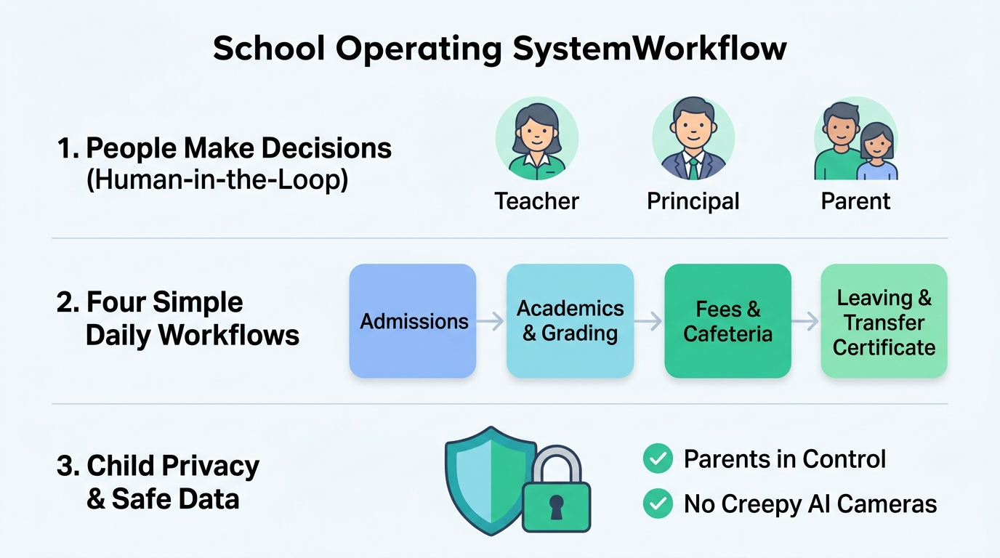

# The School Operating System: Simple & Easy Guide



### What is the School Operating System?

Think of the **School OS** as the digital engine of the school. It replaces messy spreadsheets, lost paperwork, and disconnected software with **one simple, calm system** that connects teachers, parents, and school leadership.

Most importantly, it follows one core rule: **Computers handle the repetitive paperwork, but humans always make the important decisions.**

---

## The 3 Golden Principles

```
  +------------------------------------------------------------------------+
  |  1. PEOPLE MAKE DECISIONS (Human-In-The-Loop)                          |
  |     Computers never grade children or make disciplinary decisions.     |
  |     Teachers evaluate, Principals sign off, Parents give permission.   |
  +------------------------------------------------------------------------+
  |  2. CALM & EASY (No Teacher Burnout)                                   |
  |     Morning attendance takes under 90 seconds.                         |
  |     No endless notifications—teachers are only alerted when a child    |
  |     needs extra help or has been absent multiple days.                 |
  +------------------------------------------------------------------------+
  |  3. CHILD SAFETY & PRIVACY (Safe Data Vault)                           |
  |     No creepy facial recognition cameras or emotion tracking.          |
  |     Photos and records are locked in a private encrypted vault,        |
  |     never shared with commercial consumer clouds like Google Photos.   |
  +------------------------------------------------------------------------+
```

---

## The 4 Simple Daily Workflows

### 1. Admissions (Joining the School)
* **Step 1: Parent Applies Online**: Fills form and uploads birth certificate.
* **Step 2: Registrar Checks**: Visually verifies papers and confirms age.
* **Step 3: Teacher Meets Student**: Real human teacher conducts interview (no AI scoring).
* **Step 4: Principal Approves**: Checks if seats are available and extends an offer.
* **Step 5: Parent Pays & Consents**: Pays registration and signs privacy consent. The child is enrolled!

---

### 2. Academics & Report Cards (Learning & Grading)
* **Step 1: 90-Second Attendance**: The register defaults to "All Present." The teacher taps only the 2 absent students and clicks Submit. Done in under 2 minutes.
* **Step 2: Marks Entry**: Teachers enter test marks with built-in guardrails (e.g. system stops you if you accidentally type 105 instead of 100).
* **Step 3: Board Moderation**: Academic Coordinator reviews class curves. If a question was faulty, grace marks can be awarded while keeping original scores logged.
* **Step 4: Principal Signs Off**: Report cards are **never** released automatically. The Principal clicks "Publish" when ready, unlocking reports for parents.

---

### 3. Fees & Campus POS (Money & Cafeteria)
* **Clean Math**: Every fee charged and payment received matches like an airtight bank ledger ($\text{Debits} = \text{Credits}$).
* **No Lost Cash**: When a student buys lunch at the cafeteria or books at the store, the card/badge tap updates the student's account instantly. No missing cash or untracked receipts.

---

### 4. Transfer Certificate (Moving to a New School)
In traditional schools, getting a TC requires running around campus getting stamps from the library, sports, bus, and accounts office.
* In **School OS**, when a parent clicks **Request TC**:
  * The system simultaneously checks:
    - **Accounts**: Are all fees cleared?
    - **Library**: Are all books returned?
    - **Transport**: Is the bus seat released?
    - **Teacher**: Is the conduct and attendance finalized?
  * Once all 4 show **Green**, the Principal digitally signs, generating the official TC PDF instantly.

---

## Who Can Do What? (Simple Permissions)

| Person | Can see grades? | Can enter grades? | Can publish to families? | Can see fee money? |
| :--- | :---: | :---: | :---: | :---: |
| **Principal** | All classes | Can review & adjust | **Yes (Final Sign-off)** | High-level summary |
| **Teacher** | Own classes | Yes (Own subjects) | No | No |
| **Registrar** | Basic records | No | Only admission offers | View Paid/Unpaid only |
| **Bursar (Accounts)** | No | No | Fee receipts & invoices | **Full access to ledgers** |
| **Parent** | Own child only | No | N/A | Own child's fees only |

---

## Why Parents and Teachers Love It

1. **Teachers save hours every week**: Quick attendance, no complex software navigation, no dashboard fatigue.
2. **Parents feel respected**: They control what photos or information the school can use, with full visibility over fees and report cards.
3. **School Leadership stays protected**: Complete financial audit trail, zero unaccounted cash, and full legal compliance with DPDPA 2023 and child data laws.
