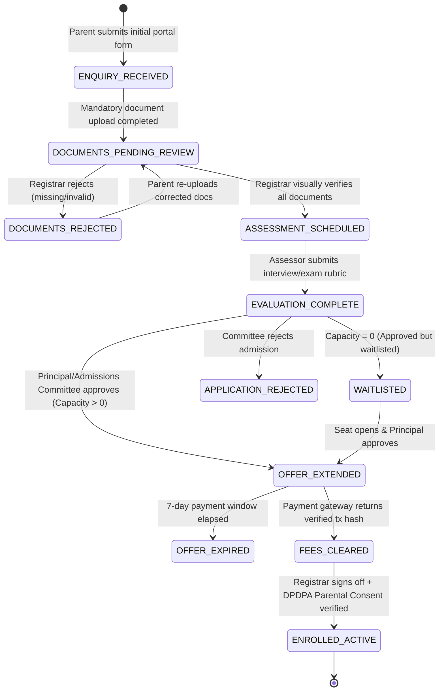
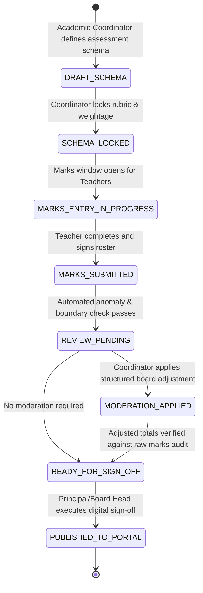
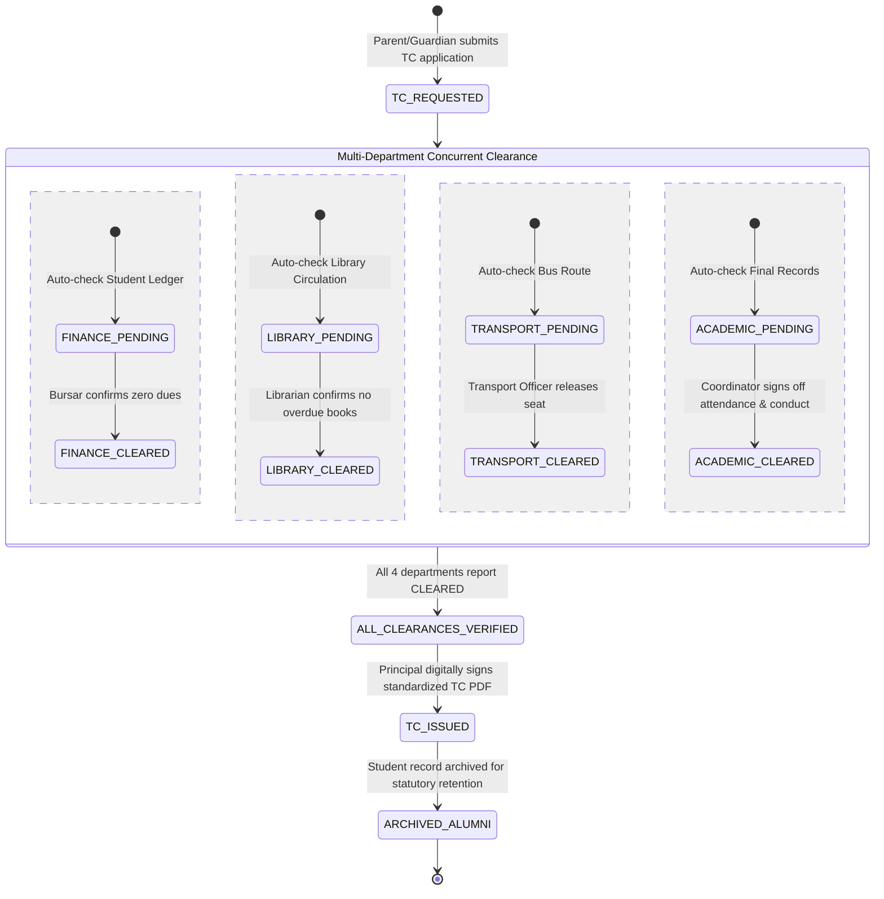
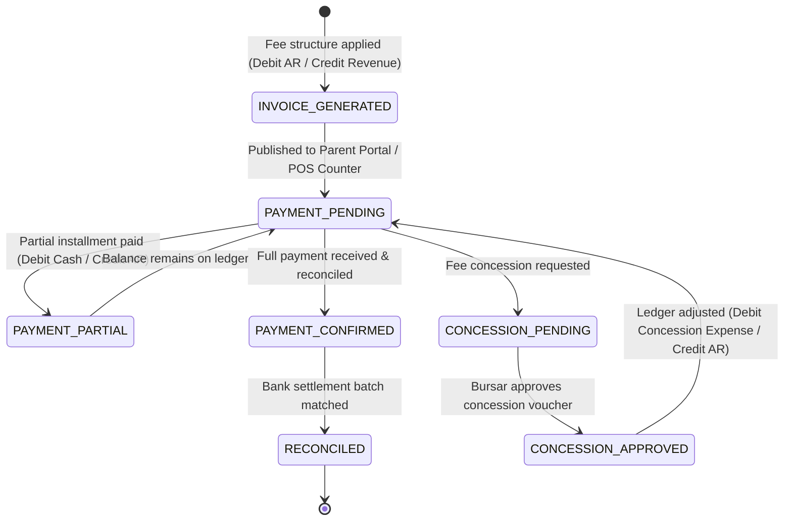

# School OS: Deterministic State Machine Specifications

## 1. Architectural Principles of State Machines in School OS

1. **Explicit Human Triggers**: State transitions representing policy, pedagogical judgment, or legal commitment require explicit authenticated human actions ("Why loop").
2. **Automated Guard & Invariant Validation**: The system ("How loop") validates all data integrity constraints, double-entry balances, capacity limits, and document signatures prior to allowing transition.
3. **Immutable Event Emission**: Every successful transition emits a strongly-typed Domain Event into the transactional outbox table within the same database transaction.
4. **Zero Silent Overwrites**: State records are append-only transition histories (`from_state`, `to_state`, `triggered_by_user_id`, `timestamp`, `metadata`, `signature`).

---

## 2. Admissions and Enrollment State Machine

### State Flow Diagram

### Transition & Guard Table

| Source State | Target State | Triggering Action | Actor | Automated Guards & Invariant Rules | Emitted Domain Event |
| :--- | :--- | :--- | :--- | :--- | :--- |
| `[*]` | `ENQUIRY_RECEIVED` | `SubmitEnquiry` | Parent | Basic validation (student DOB, guardian contacts, target grade). | `EnquiryReceivedEvent` |
| `ENQUIRY_RECEIVED` | `DOCUMENTS_PENDING_REVIEW` | `UploadApplicationDocuments` | Parent | Mandatory documents present: Birth Certificate, Previous Grade Transcript, Immunization Record. | `ApplicationSubmittedEvent` |
| `DOCUMENTS_PENDING_REVIEW` | `DOCUMENTS_REJECTED` | `RejectDocuments` | Registrar | Registrar provides mandatory rejection reason notes. | `DocumentsRejectedEvent` |
| `DOCUMENTS_PENDING_REVIEW` | `ASSESSMENT_SCHEDULED` | `VerifyDocuments` | Registrar | Document authenticity visually verified; age eligibility rule for grade level strictly verified. | `DocumentsVerifiedEvent` |
| `ASSESSMENT_SCHEDULED` | `EVALUATION_COMPLETE` | `SubmitEvaluation` | Teacher / Assessor | Formative rubric scores submitted manually. Automated AI scoring is disallowed. | `EvaluationCompletedEvent` |
| `EVALUATION_COMPLETE` | `OFFER_EXTENDED` | `ApproveOffer` | Principal / Admissions Comm. | Target grade capacity check: `CurrentActiveEnrolled + ActiveOffers < GradeCapacityMax`. | `OfferExtendedEvent` |
| `EVALUATION_COMPLETE` | `WAITLISTED` | `PlaceOnWaitlist` | Admissions Comm. | Capacity reaches ceiling; applicant placed in ranked waitlist. | `ApplicantWaitlistedEvent` |
| `OFFER_EXTENDED` | `FEES_CLEARED` | `ConfirmFeePayment` | Payment Gateway / Bursar | Verified transaction hash from payment gateway or manual POS cash receipt. | `AdmissionFeePaidEvent` |
| `FEES_CLEARED` | `ENROLLED_ACTIVE` | `FinalizeEnrollment` | Registrar | Verifiable parental consent record (DPDPA 2023) signed and logged in consent vault. | `StudentEnrolledEvent` |

### System Side-Effects of `StudentEnrolledEvent`
When the student enters `ENROLLED_ACTIVE`:
1. **Academic Bounded Context**: Automatically initializes academic transcript, links student to class roster, and opens attendance tracker.
2. **Finance Bounded Context**: Initializes `StudentLedger`, sets up academic year fee schedule, and records first-term invoice.
3. **Identity Bounded Context**: Provisions student profile and generates guardian portal credentials with least-privilege RBAC.
4. **Operations Bounded Context**: Provisions campus RFID badge access and allocates transport/meal seats if requested.

---

## 3. Academic Assessment, Moderation & Publishing State Machine

### State Flow Diagram

### Transition & Guard Table

| Source State | Target State | Triggering Action | Actor | Automated Guards & Invariant Rules | Emitted Domain Event |
| :--- | :--- | :--- | :--- | :--- | :--- |
| `DRAFT_SCHEMA` | `SCHEMA_LOCKED` | `LockAssessmentSchema` | Academic Coordinator | Schema contains valid components (FA, SA), maximum marks > 0, total weight = 100%. | `AssessmentSchemaLockedEvent` |
| `SCHEMA_LOCKED` | `MARKS_ENTRY_IN_PROGRESS` | `OpenMarksWindow` | System Scheduler | Schedule start date arrived; notification sent to subject teachers. | `MarksWindowOpenedEvent` |
| `MARKS_ENTRY_IN_PROGRESS` | `MARKS_SUBMITTED` | `SubmitClassMarks` | Subject Teacher | Real-time validation: `0 <= mark <= MaxMark`; no empty cells; special tags (Absent, Excused) verified. | `MarksSubmittedEvent` |
| `MARKS_SUBMITTED` | `REVIEW_PENDING` | `TriggerAnomalyScan` | Automated Engine | Scan for statistical anomalies: bell curve kurtosis, failure rate > threshold. Human review flagged. | `MarksReviewPendingEvent` |
| `REVIEW_PENDING` | `MODERATION_APPLIED` | `ApplyModerationPolicy` | Academic Head / Principal | Structured moderation rule logged (e.g. CBSE parity policy, grace marks for flawed questions). Raw marks immutably archived. | `ModerationAppliedEvent` |
| `REVIEW_PENDING` / `MODERATION_APPLIED` | `READY_FOR_SIGN_OFF` | `CertifyClassMarks` | Academic Head | All student marks accounted for; GPA/grades computed deterministically. | `MarksCertifiedEvent` |
| `READY_FOR_SIGN_OFF` | `PUBLISHED_TO_PORTAL` | `PublishResults` | Principal / Board Exec | Explicit human executive authorization. Makes report cards visible on Parent/Student portal. | `ResultsPublishedEvent` |

---

## 4. Transfer Certificate (TC) & Alumni Transition Clearance State Machine

### State Flow Diagram

### Transition & Guard Table

| Source State | Target State | Triggering Action | Actor | Automated Guards & Invariant Rules | Emitted Domain Event |
| :--- | :--- | :--- | :--- | :--- | :--- |
| `ENROLLED_ACTIVE` | `TC_REQUESTED` | `RequestTransferCertificate` | Parent / Registrar | Valid student record; mandatory withdrawal reason provided; effective date set. | `TCRequestedEvent` |
| Concurrent Clearance | `FINANCE_CLEARED` | `SignOffFinanceClearance` | Bursar | Balance on `StudentLedger` must be strictly `<= 0` (no outstanding dues). | `FinanceClearanceGrantedEvent` |
| Concurrent Clearance | `LIBRARY_CLEARED` | `SignOffLibraryClearance` | Librarian | Zero active book loans; any lost book fines paid or waived. | `LibraryClearanceGrantedEvent` |
| Concurrent Clearance | `TRANSPORT_CLEARED` | `SignOffTransportClearance` | Transport Officer | Bus seat allocation de-assigned effective from withdrawal date. | `TransportClearanceGrantedEvent` |
| Concurrent Clearance | `ACADEMIC_CLEARED` | `SignOffAcademicClearance` | Class Teacher / Head | Attendance percentage finalized; conduct grading recorded; last examination verified. | `AcademicClearanceGrantedEvent` |
| `ClearanceParallel` | `ALL_CLEARANCES_VERIFIED` | `AggregateClearances` | Workflow Engine | Automated barrier sync: all 4 clearance flags must be boolean `true`. | `TCClearanceCompleteEvent` |
| `ALL_CLEARANCES_VERIFIED` | `TC_ISSUED` | `ApproveAndSignTC` | Principal | Principal cryptographic signature; system generates immutable standardized TC PDF with unique tracking hash. | `TCIssuedEvent` |
| `TC_ISSUED` | `ARCHIVED_ALUMNI` | `ArchiveStudentRecord` | System Lifecycle Engine | Portal login deactivated; student status transitioned to `ALUMNI`; permanent transcript safely vaulted. | `StudentArchivedEvent` |

---

## 5. Double-Entry Fee Billing & POS Revenue Protection State Machine

### Double-Entry Accounting Rule Invariant
For every financial transaction in the School OS:
$$\sum \text{Debits} \equiv \sum \text{Credits}$$
No transaction is ever committed without maintaining this algebraic equality. Every POS transaction (cafeteria, bookstore, uniform center) issues a journal entry linked to either a student account or an anonymous POS cash ledger, fully eliminating unaccounted cash leakage.
