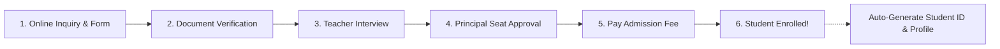
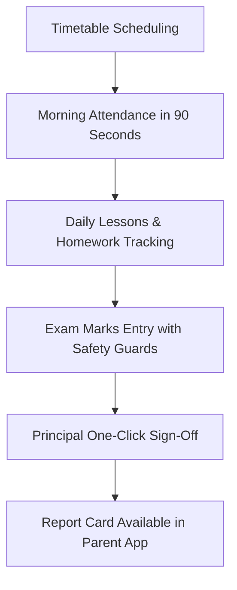
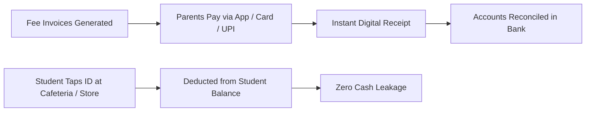
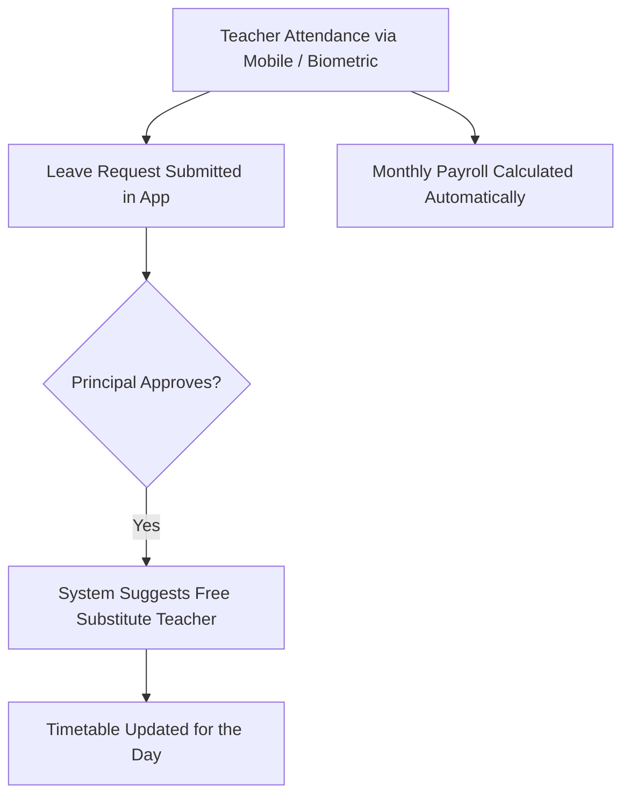
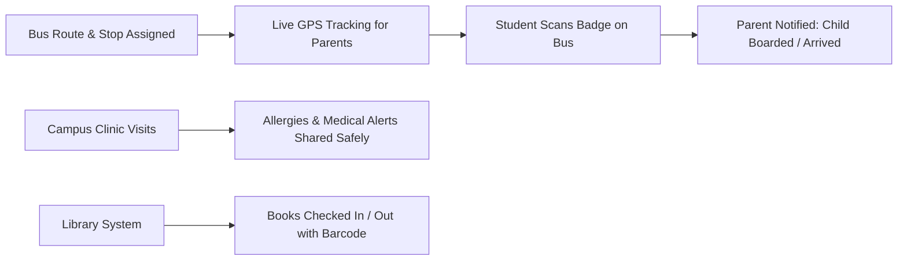
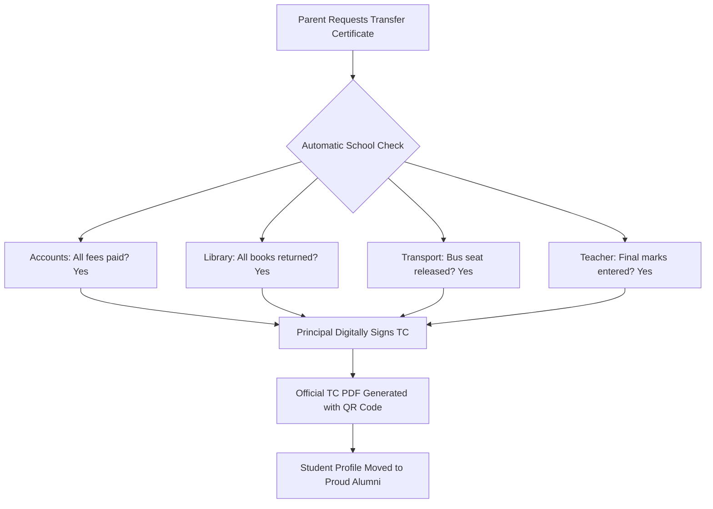

# Whole School Operating System: Complete Workflow Blueprint


## What is this system?

This is a complete, all-in-one **School Operating System (School OS)** designed to run an entire school smoothly. 

Instead of juggling 10 different spreadsheets, separate software for fees, paper attendance registers, and chaotic WhatsApp groups, **everything connects into one clean central system**.

When something happens in one department, the rest of the school updates automatically:
* When a new student joins $\rightarrow$ their name automatically appears on the teacher's roll, the bus route, and the fee ledger.
* When a teacher takes sick leave $\rightarrow$ the system instantly helps assign a substitute teacher and updates the day's timetable.
* When a child buys lunch $\rightarrow$ their ID card tap updates their account without cash handling.

---

## The 6 Pillars of the Whole School System

```
                  +----------------------------------------------+
                  |            SCHOOL OS CENTRAL HUB             |
                  |     (One Single Source of Truth for All)     |
                  +-----------------------+----------------------+
                                          |
      +-------------------+---------------+-------------------+-------------------+
      |                   |               |                   |                   |
      v                   v               v                   v                   v
+-------------+     +-----------+   +-----------+       +-----------+       +-----------+
| 1. ADMISSION|     | 2. ACADEMIC|  | 3. FINANCE|       | 4. STAFF  |       | 5. CAMPUS |
|  & NEW ID   |     |& CLASSROOM|   | & STORES  |       |   & HR    |       | & BUSES   |
+-------------+     +-----------+   +-----------+       +-----------+       +-----------+
      |                   |               |                   |                   |
      +-------------------+---------------+-------------------+-------------------+
                                          |
                                          v
                  +----------------------------------------------+
                  |         6. PARENT & STUDENT MOBILE APP       |
                  | (Live Bus, Attendance, Marks, Fees, Notices) |
                  +----------------------------------------------+
```

---

## 1. Admissions & Student Onboarding

This workflow handles a family's journey from their first inquiry to their child's first day in class.



* **Step 1: Parent Applies Online**: Parents fill out the basic application form and upload the child's birth certificate and previous grade marks.
* **Step 2: Office Verifies Documents**: The school registrar checks the documents to confirm eligibility and age.
* **Step 3: Teacher Meets Child**: A teacher conducts a friendly interview or baseline assessment to understand the child's learning stage.
* **Step 4: Principal Approves**: The principal checks class capacity and confirms the seat.
* **Step 5: Fee Payment & Privacy Consent**: The parent pays the admission deposit online and confirms privacy permissions for school media and records.
* **Step 6: The Magic Moment (Automatic Sync)**:
  * The student gets their unique **School ID Card**.
  * Their name is automatically added to the **Class Roster**.
  * If bus service was chosen, the student is assigned to the nearest **Bus Route**.
  * The **Fee Schedule** for the year is created automatically.

---

## 2. Academics & Everyday Classroom Management

This is where teachers and students spend their day. It is built to save teachers time and eliminate paperwork.



* **Timetables & Periods**: The system schedules teachers and subjects into weekly periods, preventing room or teacher double-booking.
* **90-Second Morning Attendance**:
  * The teacher opens the app. All students are already marked **"Present"** by default.
  * The teacher taps only the 1 or 2 absent students and hits **Submit**. Done in under 90 seconds!
  * If a student is absent, the parents receive an instant gentle message.
* **Homework & Assignments**: Teachers post homework and due dates directly to the student portal.
* **Exams & Report Cards**:
  * Teachers enter exam marks. The system prevents typos (e.g., it blocks entering "105" on a 100-mark test).
  * If an exam question was unfair or had an error, the academic head can grant +2 grace marks fairly across the whole grade.
  * **Principal Sign-off**: With one click, the Principal approves the batch, instantly generating clean, beautiful PDF report cards.

---

## 3. Fee Collection, Accounts & Campus Stores (POS)

Every single payment is tracked with airtight accounting, preventing lost money or billing mistakes.



* **Tuition Fee Schedules**: Automatically calculates quarterly fees, annual discounts, and sibling concessions.
* **Easy Online Payment**: Parents pay directly from their phones (UPI, Credit/Debit Card, Netbanking). Instant receipt sent to their app.
* **Cashless Campus Stores (POS)**:
  * **Cafeteria**: Students tap their school smart ID card to get lunch.
  * **Uniform & Book Shop**: Purchases are logged directly to the student's account.
  * **Zero Lost Cash**: Cashiers don't handle loose cash, completely eliminating missing receipts or cash-drawer shortages.

---

## 4. Teachers & Staff Management (HR)

Keeps teachers happy, organized, and supported throughout the school year.



* **Staff Clock-in**: Quick mobile clock-in or biometric check-in upon arrival.
* **Instant Substitute Teacher Finder**:
  * When a teacher applies for sick leave, the system instantly sees which qualified teachers are free during those periods.
  * One tap assigns the substitute teacher, updating their timetable immediately without morning panic.
* **Payroll Made Simple**: Calculates monthly salaries, deductions, and allowances accurately based on approved leaves and workdays.

---

## 5. Buses, Health Clinic & Campus Safety

Ensures children are safe from the moment they leave home until they return.



* **School Bus & GPS Tracking**:
  * Parents can see their child's bus moving live on a map.
  * Alerts notify parents 10 minutes before the bus reaches their stop.
  * Driver & attendant details are verified and visible.
* **School Clinic & Health Records**:
  * Tracks allergies, medications, and infirmary visits.
  * If a child is allergic to peanuts, the cafeteria and class teacher see a clear safety badge on their profile.
* **School Library**:
  * Barcode scanning lets students borrow and return books in seconds.

---

## 6. The Parent & Student Experience

Schools succeed when communication with families is clear, transparent, and respectful.

* **One Single Mobile App for Parents**:
  * View attendance history calendar.
  * Track homework and upcoming tests.
  * Pay school fees with 1 click.
  * Receive urgent notices and event calendars.
  * Chat with class teachers during official school hours.
* **Student Portal**:
  * Check daily timetable, homework assignments, and club activities.
  * View digital library books.

---

## 7. The End-of-School Journey (Transfer Certificate & Graduation)

When a student finishes school or relocates, parents typically have to run from office to office getting paper signatures. **School OS automates this completely:**



---

## Summary: How Everyone Benefits

| Role | Before School OS | With School OS |
| :--- | :--- | :--- |
| **Principal** | Blind to problems, drowning in paper forms and complaints. | Real-time school dashboard, 1-click approvals, complete control. |
| **Teacher** | 30 minutes wasted on roll call and marksheets every day. | 90-second attendance, zero paperwork, more time to teach. |
| **Accountant** | Chasing unpaid fees, reconciling lost cafeteria cash. | All payments online, automatic receipts, zero cash leakage. |
| **Parent** | Out of the loop, guessing when the bus arrives, lost notices. | Live bus map, instant fee payment, clear report cards on phone. |
| **Student** | Heavy paper diaries, lost library cards, stressful queues. | 1 smart badge for library, bus, and meals; clear homework app. |
